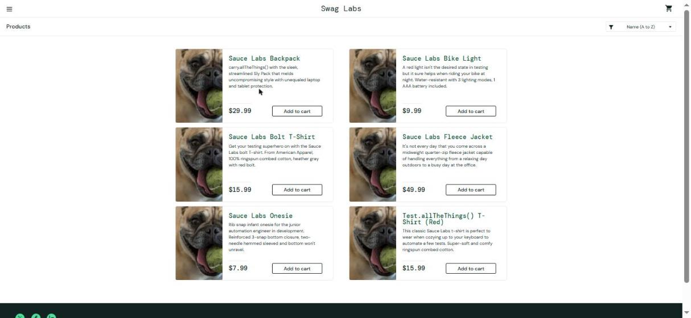

# BUG-003 - Botão "Adicionar ao carrinho" da jaqueta de lã (Fleece Jacket) não adiciona o produto (usuário problem_user)

**Gravidade:** Alta (o cliente não consegue comprar esse produto)
**Usuário:** problem_user
**Ambiente:** Windows, navegador Microsoft Edge
**Data:** 16/10/2026
**Status:** Confirmado (reproduzido em dois navegadores/painéis)

Observação: o site é em inglês. Os nomes de botões aparecem aqui em português, com o nome original entre parênteses.

## Passos para reproduzir
1. Abrir https://www.saucedemo.com
2. Entrar com o usuário `problem_user`
3. Na lista de produtos, clicar em "Adicionar ao carrinho" (Add to cart) da Sauce Labs Fleece Jacket (jaqueta de lã)
4. Olhar o botão e o ícone do carrinho

## Resultado esperado
O botão vira "Remover" (Remove) e o carrinho aumenta em 1 item.

## Resultado obtido
Nada acontece. O botão continua "Adicionar ao carrinho" e o carrinho não muda. Clicando mais de uma vez, o resultado é o mesmo.

## Evidências

## Observações
Com o mesmo usuário, o botão da mochila (Sauce Labs Backpack) funciona normal (vira "Remover" e o carrinho sobe para 1). Em 13/11/2026 testei os outros produtos com o problem_user: a camiseta Bolt (Sauce Labs Bolt T-Shirt) e a camiseta vermelha (Test.allTheThings() T-Shirt (Red)) têm o mesmo defeito. A lanterna (Bike Light) e o body (Onesie) funcionam normal. Ou seja, 3 dos 6 produtos não podem ser comprados com esse usuário.
