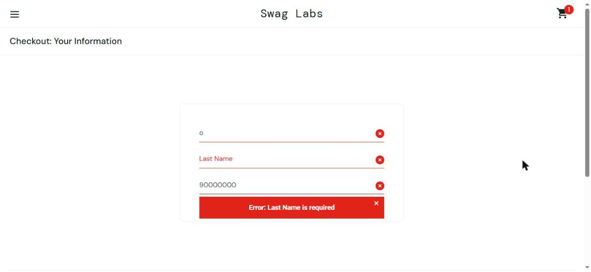

# BUG-004 - Ao digitar o sobrenome, o texto apaga o primeiro nome e a compra não pode ser concluída (usuário problem_user)

**Gravidade:** Crítica (impede o cliente de terminar a compra)
**Usuário:** problem_user
**Ambiente:** Windows, navegador Google Chrome
**Data:** 13/11/2026
**Status:** Confirmado

Observação: o site é em inglês. Os nomes de botões e campos aparecem aqui em português, com o nome original entre parênteses.

## Passos para reproduzir
1. Abrir https://www.saucedemo.com
2. Entrar com o usuário `problem_user`
3. Adicionar a mochila (Sauce Labs Backpack) ao carrinho
4. Abrir o carrinho e clicar em Finalizar compra (Checkout)
5. Digitar "Kelly" no campo Primeiro nome (First Name)
6. Clicar no campo Sobrenome (Last Name) e digitar "Porto"
7. Preencher o CEP (Zip/Postal Code) e clicar em Continuar (Continue)

## Resultado esperado
O Primeiro nome fica "Kelly", o Sobrenome fica "Porto" e o site avança para o resumo do pedido.

## Resultado obtido
O que é digitado no Sobrenome vai para o campo Primeiro nome, que fica só com a última letra ("o"). O Sobrenome continua vazio e aparece a mensagem "Erro: o sobrenome é obrigatório" (Error: Last Name is required). Não tem como passar dessa tela.

## Evidências

## Observações
Com o usuário standard_user os campos funcionam normal e a compra é concluída (ver CT09).
